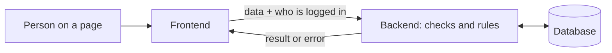
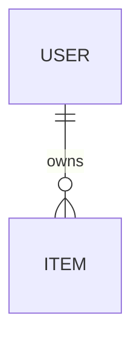

# How {{APP_NAME}} works

> The big picture of this app: its parts, its flows, its logic and its data,
> plus the technical terms you've picked up along the way. Claude keeps it up
> to date as the app grows; ask about anything in it.

## The big picture

```mermaid
mindmap
  root(({{APP_NAME}}))
    People
      admin: manages users
      users: sign up, log in, use the app
    Flows
      log in
      manage users
      example items, replaced by the first real feature
    Data
      users
      items, each owned by one user
    Parts
      frontend: the pages, React
      backend: the rules, FastAPI
      database: the data, PostgreSQL
```

The app has three main parts, each running in its own container: the
**frontend** (the pages people use in the browser), the **backend** (which
receives what the pages send, applies the business logic, and reads or writes
the data), and the **database** (where everything is stored, as records linked
to each other). A short job also runs at every start: it brings the database
structure up to date and adds starter data.



## Flows

**Logging in.** A person enters their email or username and password. The
backend compares the password with the stored, scrambled version (passwords
are never stored as typed) and gives the browser a token, a signed proof of
who they are that goes with every later request. It lasts 8 days.

**Managing users.** Only admins can add, edit or remove users. Email and
username must be unique, and an admin can't delete their own account.

**Items (example).** Each user sees and changes only their own items; admins
see all of them. Deleting a user deletes their items. This is the template's
example feature; it's replaced by the first real feature.

## The data



## Glossary

- **Frontend**: the part of the app that runs in the browser: the pages people see and use.
- **Backend**: the part that runs on the server: it applies the rules and talks to the database.
- **Database**: where the app stores its data permanently, as records linked to each other.
- **Container**: an isolated environment that runs one part of the app, the same way on any machine.

## How you like to learn

<!-- Notes on what depth and style of explanation works for her. -->
